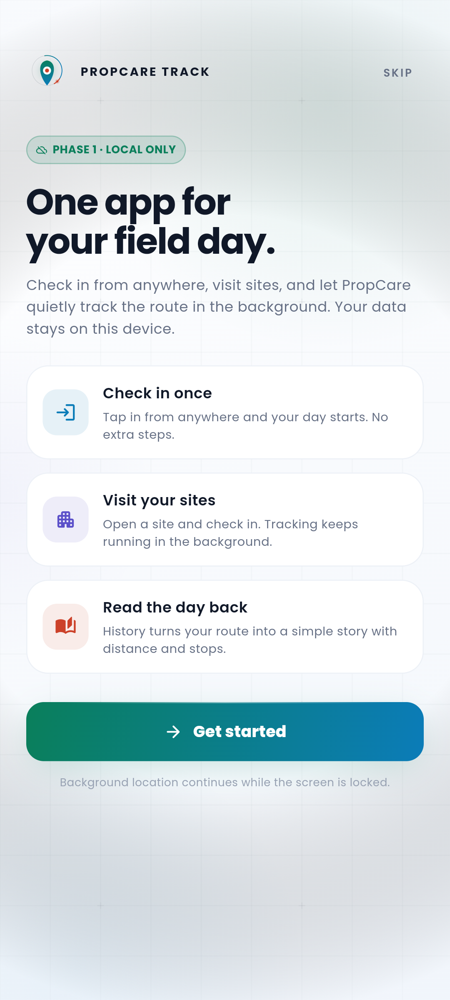
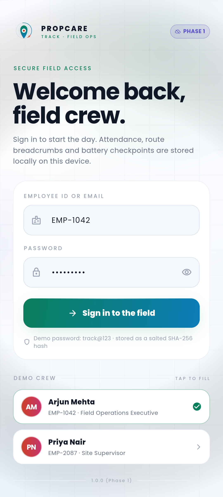
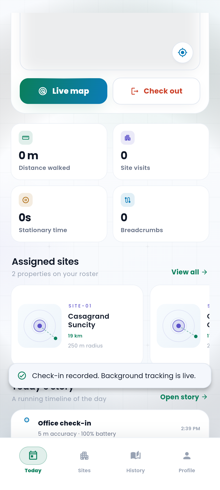
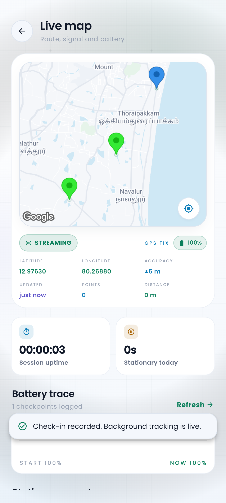
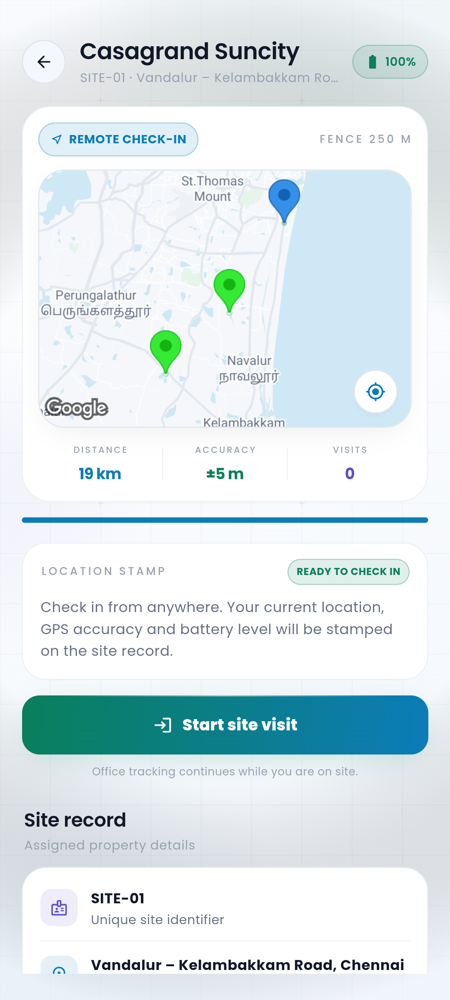
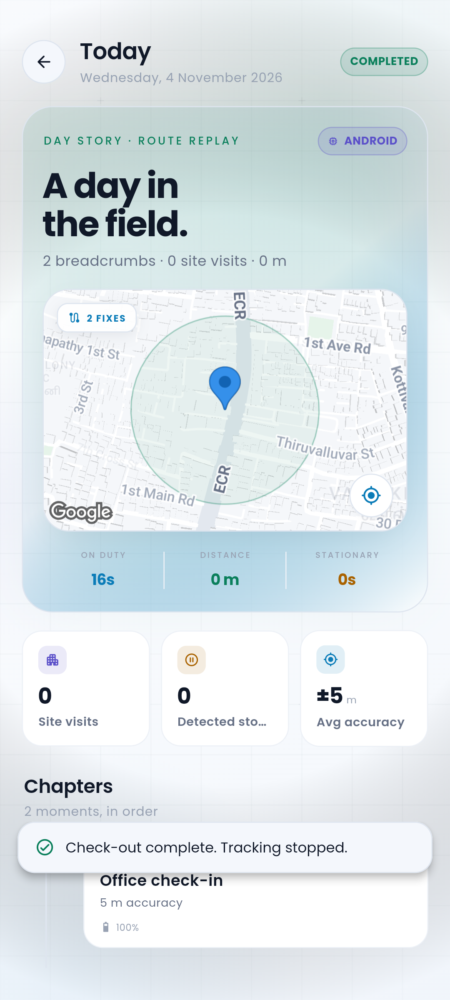

# PropCare Track — Phase 1

**Every stop, accounted for.**

PropCare Track is a local-first field-tracking and site-attendance app for property-care employees. Phase 1 runs entirely on the device: no backend, no web dashboard, no server sync. The data model and sync flags are already in place for Phase 2.

Built with Flutter, a Kotlin foreground location service on Android and a Core Location manager on iOS. The visual language is **Paper Atlas** — a bright white canvas, soft ink-blue type, Poppins throughout, elevated white cards, mint/cyan/coral accents, real Google Maps on mobile with a custom-painted radar fallback, and a cinematic day-story replay.

---

## Screens

| Onboarding | Sign in | Today, tracking live |
| --- | --- | --- |
|  |  |  |

| Live map | Site detail | Cinematic day story |
| --- | --- | --- |
|  |  |  |

All 14 captures (welcome, login, office attendance, sites, history, profile, check-out confirmation and the story replay) live in [`screenshots/`](screenshots) and are generated by `tool/capture_screenshots.sh`.

---

## What is included

| Area | Details |
| --- | --- |
| Attendance | Check-in works from anywhere and starts background tracking. Check-out stops it and closes the day. Current location, accuracy and battery are stamped. |
| Sites | Two seeded sites with unique IDs and configurable radii. Site check-in/out never stops office tracking. |
| Tracking | Native background services on Android/iOS; deterministic journey simulator on macOS/desktop. |
| Stationary detection | 20-second threshold, ~30 m anchor radius, 48 m break hysteresis, start/end/duration stored. |
| Battery | Logged at check-in, periodically during tracking, at every site in/out, at check-out and logout. |
| Recovery | Interrupted sessions after force-close/reboot can be resumed or closed without deleting records. |
| Logout | Allowed at any time. Stops native tracking, marks the session interrupted, preserves all rows, and never counts as office check-out. |
| History | Daily attendance archive, route replay story, stationary stops, battery trace and storage stats. |
| Edge cases | GPS off, permissions revoked, no network, poor accuracy, force-close, reboot, low battery, duplicates, remote check-in. |

---

## Demo

Two seeded employees. Password for both: `track@123`.

| Employee ID | Name | Role |
| --- | --- | --- |
| `EMP-1042` | Arjun Mehta | Field Operations Executive |
| `EMP-2087` | Priya Nair | Site Supervisor |

The login screen is prefilled with `EMP-1042` / `track@123`. Tap a demo-crew card to switch employee.

### Desktop simulation

macOS, Windows and Linux builds run the same app against a compressed journey simulator. It emits the exact event contract used by the native services, so every screen, the stationary detector and the database are exercised without a phone.

1. `flutter run -d macos`
2. Sign in.
3. Check in for the day. You can do this from anywhere; your current location is stamped.
4. Wait ~23 seconds at the office to see the first stationary event.
5. Open **Sites** → **Casagrand Suncity** → **Jump to site** → start the site visit.
6. Hold to check out of the site. Tracking stays live.
7. Return to **Today** → **Check out** → hold to confirm.
8. Open **History** → tap the completed day to replay the story.

Demo-only controls (`Jump to office`, `Jump to site`, `Refresh fix`) appear only when `AppConfig.isSimulationEnvironment` is true.

---

## Run it

```bash
flutter pub get
flutter run -d android     # real background service
flutter run -d ios         # Core Location + background mode
flutter run -d macos       # simulator
```

### Android

The foreground service is declared with `foregroundServiceType="location"`. Permissions in `AndroidManifest.xml`:

- `ACCESS_FINE_LOCATION`, `ACCESS_COARSE_LOCATION`, `ACCESS_BACKGROUND_LOCATION`
- `FOREGROUND_SERVICE`, `FOREGROUND_SERVICE_LOCATION`
- `POST_NOTIFICATIONS`, `RECEIVE_BOOT_COMPLETED`, `WAKE_LOCK`

On first check-in the app requests foreground location, then **Always allow** background location. If the employee grants only "While using the app", check-in is blocked with a clear explanation.

### iOS

`Info.plist` contains the three location usage strings and `UIBackgroundModes: [location]`. On first check-in the app asks for **Always** authorization. The blue background-location indicator remains visible while tracking, by design. The deployment target is **iOS 14.0** because the Google Maps iOS SDK requires it.

### Google Maps

Mobile builds render a real Google Map (`lib/core/widgets/google_route_map.dart`) with office/site markers, radius circles, the live fix, an accuracy circle and the stored breadcrumb trail as a polyline. Desktop and widget tests fall back to the offline custom-painted `RadarMap`.

The API key is wired into:

- `android/app/src/main/AndroidManifest.xml` → `com.google.android.geo.API_KEY`
- `ios/Runner/AppDelegate.swift` → `GMSServices.provideAPIKey(...)`

To use your own key, replace it in both places, then enable **Maps SDK for Android** and **Maps SDK for iOS** for that key in Google Cloud Console and allow billing. On Android the key must be allowed for the app's package (`com.example.propcare_track`) and signing certificate.

---

## Project layout

```text
lib/
  app.dart                     Splash → onboarding → login → home routing
  core/
    config/app_config.dart     Office, sites, demo crew, tracking constants
    theme/                     Paper Atlas colors and Poppins type system
    utils/                     Geo math, proximity rules, formatters
    widgets/                   Background, logo, glass, buttons, maps
  data/
    db/app_database.dart       sqflite schema + seeding
    models/                    Immutable domain models
    repositories/              Auth, config, attendance, tracking, history
  services/
    app_controller.dart        Single state machine for the day
    location_service.dart      Geolocator + permission report
    stationary_detector.dart   Reference 20-second detector (Dart)
    tracking/                  Native bridge, simulator, demo position
  ui/
    screens/                   Today, Sites, History, Profile, live map, …
    sheets/                    Interrupted-session, logout, permissions
    widgets/app_page.dart      Page chrome, nav bar, banners, sheets
android/app/src/main/kotlin/…  TrackingService, TrackingBridge, queue
ios/Runner/…                   LocationTrackingManager, TrackingStore
test/                          unit, workflow, full-flow and responsive tests
integration_test/              desktop E2E, native bridge smoke, screenshot capture
test_driver/                   integration-test screenshot driver
tool/                          icon generation and screenshot capture
screenshots/                   captured Paper Atlas screens
```

More detail: [Architecture](docs/ARCHITECTURE.md) · [Database](docs/DATABASE.md) · [Tracking engine](docs/TRACKING.md) · [Testing](docs/TESTING.md).

---

## Verification

```bash
flutter analyze                 # zero issues
flutter test                    # 13 unit + widget tests
flutter test integration_test/native_tracking_smoke_test.dart -d <device>
tool/capture_screenshots.sh emulator-5554
flutter test integration_test/app_test.dart -d macos   # desktop simulator
flutter build apk --debug
flutter build ios --simulator --debug
flutter build macos --debug
```

The native smoke test starts a real Kotlin/Swift tracking session, waits for a fix, checks the durable queue and stops. It has been run on an iPhone 17 Pro simulator (iOS 26.5) and an Android API 37 emulator. The capture script walks welcome → login → check-in → live Google Map → sites → profile → check-out → day story against the real Android service and saves 14 PNGs.

The desktop integration test walks onboarding → login → check-in → stationary stop → site check-in/out → check-out → day story → logout against a real sqflite database.

---

## Phase 1 boundaries

Out of scope by design:

- Backend APIs and authentication server
- Web dashboard / admin console
- Cross-device sync (the `sync_status` columns are ready for it)
- Payroll, leave, expense or project-management modules

Every record is stored locally and marked `pending` so a Phase 2 sync worker can push it without a schema migration.
